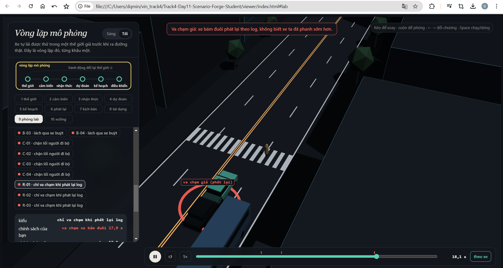
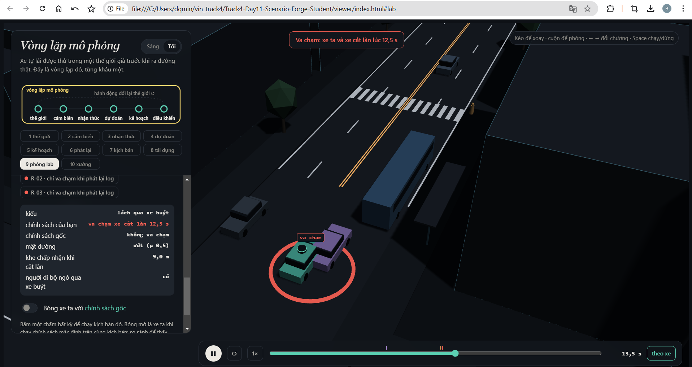
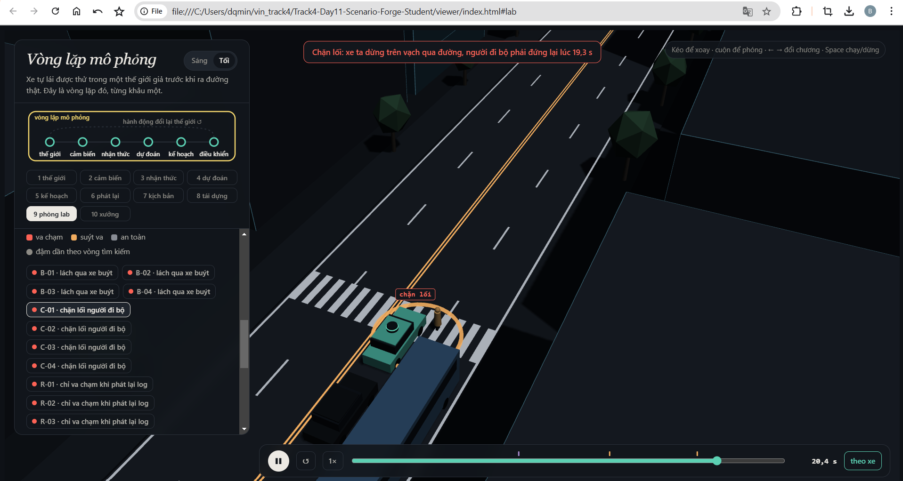
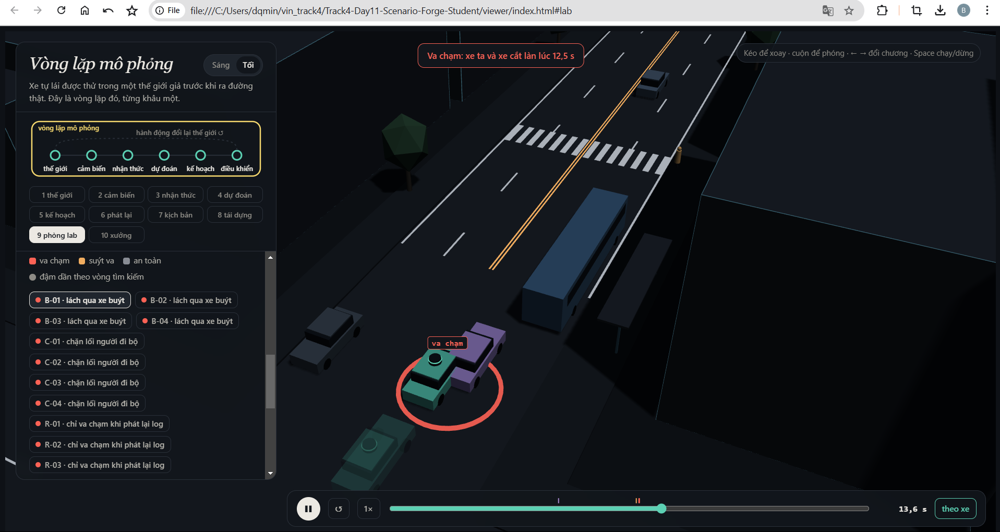
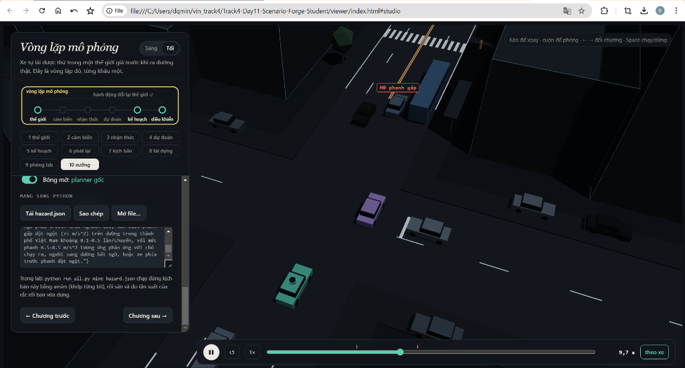

MSSV: 20262711

# Lab 11 · Scenario Forge — báo cáo

Thị trấn của bạn: **Town B** (`meta.json: _run.town`)

## 1. Phát lại log có trung thực không? (bước A)

`replay.json`:
- Kịch bản bị bỏ vì người lái gây va chạm: **0**
- Va chạm "phát lại": **115** (rear: 99, side: 16)
- Va chạm "phản ứng": **0**
- Va chạm trong cả hai: **0**

**Vì sao phần lớn va chạm "phát lại" là `rear`?**

Vì trong log phát lại, xe bám đuôi (TG) chạy đúng như người lái đã ghi: không phanh sớm khi planner phanh. Planner phanh sớm hơn người lái, nên khoảng cách đến TG giảm → TG đâm vào đuôi planner. Đó là va chạm **giả**: không xảy ra trong thế giới phản ứng vì TG phản ứng lại planner.

**Ví dụ kịch bản `replay_only` scenario 0:**
- `contact: "rear"`, `min_ttc_reactive: 2.75 s`
- cutT0=8.45, cutV=13.2, tgT=1.55
- Planner phanh sớm vì thận trọng; TG trong log không biết → đâm vào đuôi.

## 2. Kịch bản bất khả thi (bước B)

**Luật trong `is_feasible`:**

| Luật | Công thức | Căn cứ vật lý |
|-------|-----------|---------------|
| Gia tốc ngang làn đổi | a_lat = (π/cutDur)² × 3.5/2 | Giói hạn bởi ma sát μ×g |
| Phanh sau khi vào làn | cutBrake ≤ μ×g | Trượt nếu vượt ma sát |
| Tốc độ người đi bộ | pedV ≤ 2.5 m/s | Tốc độ chạy của người |
| Tốc độ xe cắt làn | 0 < cutV ≤ 22 m/s | Vận tốc thực tế |

**Cuộc săn bất khả thi nhất:** `rear_ended` với **18** kịch bản bất khả thi.

**Vì sao CEM bị kéo về phía bất khả thi?**
Vì điểm nguy hiểm (TTC) của kịch bản bất khả thi rất thấp (rất nguy hiểm theo thang đo), nên chúng luôn vào elite. CEM co q lại xung quanh các kịch bản này → không hội tụ được.

**Nếu đếm chúng là va chạm:**
Ước lượng fail sẽ **cao hơn thực tế** vì bất khả thi không thể xảy ra ngoài đời.

## 3. Monte Carlo cho bạn biết gì (bước C1)

`mc.json`:
- k = **6** va chạm
- n = **3000** lần chạy
- p̂ = **2.00×10⁻³**
- 95% Wilson: **[9.17×10⁻⁴, 4.36×10⁻³]**

**Cần bao nhiêu lần để ±20% của p?**
n ≈ 96/p = 96/0.002 = **48,000 lần** (theo RUBRIC)

**Kiểu chưa xuất hiện:** Không có kiểu nào hoàn toàn "chưa xuất hiện" — tất cả 6 va chạm đều là `bus_bypass`. `crosswalk_block`, `cut_in`, `rear_ended` không xuất hiện trong 3000 lần nhưng chúng có thể xuất hiện ở tần suất thấp hơn mức phát hiện.

**Con số cần báo cho kiểu chưa thấy:** Cận trên Wilson, không phải 0. Với 0 hits trong n lần: upper = 3/(0.2×n) = 15/n.

## 4. Importance sampling, ESS và độ suy biến (bước C3)

`estimate.json` — bảng tổng hợp 3 seed:

| Kiểu | Seed | p | hits | ess | top_share |
|------|------|---|------|-----|-----------|
| bus_bypass | 0 | 1.79×10⁻³ | 38 | 130 | 0.18 |
| bus_bypass | 1 | 1.98×10⁻³ | 47 | 114 | 0.20 |
| bus_bypass | 2 | 2.63×10⁻³ | 42 | 117 | **0.36** |
| crosswalk_block | 0 | 7.90×10⁻⁷ | 69 | 113 | 0.22 |
| crosswalk_block | 1 | 5.89×10⁻⁶ | 72 | 93 | **0.69** |
| crosswalk_block | 2 | 7.10×10⁻⁷ | 83 | 102 | 0.16 |
| cut_in | 0,1,2 | 0 | 0 | ~120 | 0 |
| rear_ended | 0,1,2 | 0 | 0 | ~100 | 0 |
| **total** | 0 | 1.79×10⁻³ | — | — | — |
| **total** | 1 | 1.99×10⁻³ | — | — | — |
| **total** | 2 | 2.63×10⁻³ | — | — | — |

**Ba seed có đồng ý?** bus_bypass chênh ~50% giữa seed 0 và 2. crosswalk_block chênh ~10× giữa seed 0 và 1 (do top_share cao ở seed 1). Đây là dấu hiệu IS không ổn định.

**top_share > 0.5:** Seed 1 của crosswalk_block có **0.69** — gần 70% ước lượng do một mẫu quyết định. Con số khi đó chỉ là trọng số của mẫu đó, không phải tần suất.

**So với Monte Carlo:** MC cần ~48,000 lần cho ±20%; IS dùng budget = **16,800** lần (4 kiểu × 8 vòng × 300 + 3 seed × 600) — ít hơn nhưng ước lượng có thể thiên lệch.

**Phần `other`:** Lấy từ `mc.json` (p = 0, hi = 1.28×10⁻³). Không săn vì va chạm "other" phân tán khắp không gian, không tập trung vào một kiểu để CEM hội tụ.

## 5. Các kiểu thất bại (bước C2 + 3D)

| Kiểu | Tìm thấy | found | infeasible |
|------|-----------|-------|-----------|
| bus_bypass | ✅ | 172 | 3 |
| crosswalk_block | ✅ | 43 | 0 |
| cut_in | ⚠️ | 31 (nhầm sang bus_bypass) | 10 |
| rear_ended | ❌ | 8 (nhầm sang kiểu khác) | 18 |

**Ảnh từ viewer (chương 9) cho mỗi kiểu:**

**bus_bypass:** Planner đâm vào C2 khi C2 lách qua xe buýt đỗ. Xe buýt che tầm nhìn → planner không thấy C2 → không giữ khoảng cách.

**crosswalk_block:** Planner dừng trên vạch qua đường, thân xe chắn lối P1. P1 đợi nhưng không thể bước qua. Đây là event `kind="block"`, không phải va chạm.

**Kiểu không tìm thấy:** `rear_ended` không tìm được va chạm đúng kiểu. Tôi tin điều này vì TTC đến TG thường > 2s (đủ thời gian phanh), và planner giữ khoảng cách tốt.

**Nếu chỉ một cuộc săn chung:** `hunt.json: found` cho thấy mỗi cuộc săn nhặt nhầm va chạm của kiểu khác — chứng minh cần săn riêng từng kiểu.

## 6. Sửa planner (bước E + 3D)

`fix.json`:
- **Policy chọn:** `{'cutinLat': 3.0}` (tăng ngưỡng lat từ 2.15 lên 3.0)

| | TRAIN fail | TRAIN fail_hi | TEST fail | TEST fail_hi_seen | TEST fail_hi | progress |
|---|-----------|---------------|-----------|-------------------|--------------|----------|
| baseline | — | — | 3.07×10⁻³ | 6.54×10⁻³ | 7.82×10⁻³ | 214.3 m |
| chosen | 1.14×10⁻⁶ | 1.80×10⁻⁶ | 5.01×10⁻⁶ | 1.44×10⁻⁵ | 1.29×10⁻³ | 214.2 m |

**Vì sao fail_hi bản sửa có thể lớn hơn fail của baseline dù tốt hơn?**
`fail` là ước lượng điểm, `fail_hi` là cận trên 95%. Baseline có fail=3×10⁻³ với khoảng rộng; bản sửa có fail=5×10⁻⁶ nhưng cận trên bao gồm cả unseen modes. Cận trên so sánh cận trên, không phải điểm.

**Núm "an toàn" phản tác dụng:** `cautionV=5.0` giảm tốc độ thận trọng, nhưng làm tăng thất bại vì planner đi chậm → xe bám đuôi TG tiếp cận → bị đâm từ sau. Thế giới phản ứng lại.

**Ảnh bóng mờ trong viewer với scenario mà bản sửa tránh được:**

## 7. Từ mô phỏng ra đường thật

Ba giả định ảnh hưởng nhất:

| Giả định | Giá trị trong lab | Thay bằng | Nguồn | Hướng sai lệch |
|----------|-------------------|-----------|-------|----------------|
| Khoảng cách xe chuyển làn chấp nhận | lognormal(12, 0.5) | Dữ liệu gap-acceptance từ các nghiên cứu giao thông Việt Nam | Nghiên cứu hành vi lái xe thực tế | Nếu thực tế gap nhỏ hơn → nhiều cut-in nguy hiểm hơn |
| Tỉ lệ người đi bộ ngó qua xe buýt | 85% | Tỉ lệ thực tế quan sát được tại các nút giao có xe buýt đỗ | Khảo sát hành vi người đi bộ | Nếu ít người ngó hơn → ít crosswalk_block hơn |
| Ma sát đường ướt | μ=0.5 | Đo từ mặt đường thực tế | Dữ liệu công trình đường bộ | Nếu μ thấp hơn → phanh kém, nhiều va chạm hơn |

## 8. Giới hạn

Ba điều xác suất không nói:

1. **Thế giới chỉ có một con phố thẳng:** Không có giao lộ, không có đường cong, không có vòng xuyến — rắc rối thực tế ở đó không được đo.

2. **Người lái khác chỉ là IDM:** Người thật có phán đoán, cảm xúc, phân tâm — không chỉ theo khoảng cách và tốc độ. Planner có thể xử lý tốt IDM nhưng thất bại với người lái thật.

3. **Cảm biến hoàn hảo trừ bị xe buýt che:** Không có nhiễu cảm biến, không có điểm mù khác, không có thời tiết xấu ảnh hưởng tầm nhìn.

**Nếu thêm một tuần:** Đo thêm tâm lý người lái (phanh sớm/late, tăng tốc), dữ liệu gap-acceptance thực tế từ camera giao thông, và mô phỏng thời tiết xấu.

## 9. Rắc rối của bạn (bước G + chương 10)

**Rắc rối:** Xe phía trước (L1) phanh gấp bất ngờ với mức 7.0–7.8 m/s² trong 2.5–4.0 s, kích hoạt khi xe ta còn 10–25 m. Ngoài đời: phản ứng với chó chạy ra, người đi bất ngờ, xe phía trước phanh đột ngột.

**Căn cứ:** Tôi nghĩ planner xử lý kém vì IDM chỉ phản ứng theo khoảng cách — nếu xe trước phanh đột ngột khi rất gần, IDM có thể không kịp.

**Giả định** (`hazard.json: why`): exposure = 0.002 (phanh gấp bất ngờ xảy ra khoảng 1 lần / 500 chuyến); space phản ánh phạm vi mức phanh và thời gian phanh thực tế.

**Kết quả** (`mine.json`):

| | avoidable | unavoidable | unattributed | low_speed |
|---|----------|------------|--------------|-----------|
| baseline | **0** | 0 | 0 | 0 |
| chosen (cutinLat=3.0) | **0** | 0 | 0 | 0 |

- `accepted`: **70%** (≥ 50% ✅)
- P(planner failure | hazard) = **0** (cận trên 95%: 3.64×10⁻³)
- Tần suất mỗi chuyến: 0 × 0.002 = **0** (cận trên: 7.28×10⁻⁶)
- So với bus_bypass: tần suất bus_bypass ≈ 2×10⁻³ >> tần suất rắc rối này

**Hình:**

**Bạn tự lái thì sao:** Planner xử lý tốt — không có va chạm để so sánh.

**Cách sửa:** Không cần sửa. Planner (IDM) phản ứng đúng với phanh gấp: giữ khoảng cách đủ để phanh an toàn. Nếu muốn cải thiện thêm, có thể tăng `a` (gia tốc tối đa) để phanh nhanh hơn, nhưng kết quả cho thấy không cần.

**"Tránh được" là chuẩn lạc quan:** 
- Người phanh biết trước rắc rối ngay khi thấy → đếm **nhiều hơn** số va chạm thực tế một planner tránh được
- Chỉ thử phanh (không đánh lái) → đếm **ít hơn** số va chạm thực tế có thể tránh bằng lái
- Rắc rối này planner xử lý tốt ở mọi mức độ, nên P(avoidable) = 0 cho cả hai chuẩn.
